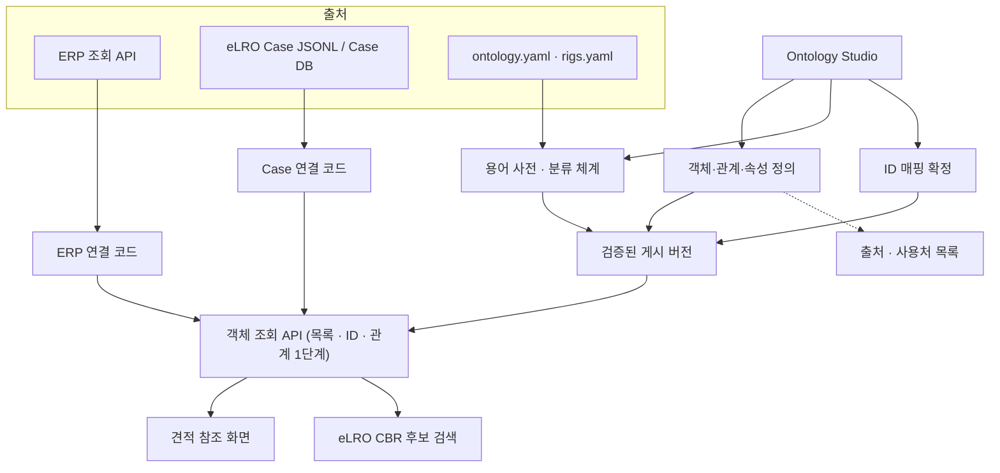

# 사내 Ontology Studio PoC 실행안 (v2)

> 목표 — 실제로 동작하는 ERP 조회 API와 eLRO 레시피 Case 데이터 위에 객체·관계·용어·ID 매핑을 정의하는 얇은 온톨로지 계층을 만들고, ① 연결 정확성 ② 실제 변경 요청의 처리 비용 ③ 업무 기여를 서로 분리해 측정. 범용 조회 엔진은 측정 결과로 필요성이 확인될 때만 확장.

## 0. v1 대비 변경 요약

| 항목 | v1 | v2 | 변경 이유 |
|---|---|---|---|
| 1단계 업무 | EBP 프로젝트 → 장비 → 생산 이슈 | ERP 고객사 → 프로젝트 → BOM → 발주 품목 (견적 참조) | ERP에 장비·생산 이슈 테이블 없음, EBP는 빈 템플릿. ERP 조회 API는 실제 동작 |
| 2단계 업무 | 제품·결함·레시피 버전·평가 사례 (가상 모델) | eLRO 실제 모델: Target·Session·Trial·Case·Rig·광학계 | 레시피 채널 값은 Rig 없이 해석 불가. 실제 스키마와 일치시킴 |
| 두 업무의 관계 | 공유 객체 없음 | 둘 다 "유사 사례 검색 → 해답 재사용" 구조, 고객사·프로젝트로 교차 연결 | 재사용 검증이 범용 CRUD 시연과 구분되도록 |
| Studio 범위 | 설정 기반 공통 조회 엔진 | 메타데이터 등록·용어 사전·ID 매핑·출처/사용처. 조회는 연결 코드 유지 | 핵심 업무 로직(BOM 트리, 가격 통계)은 동등 키 관계로 표현 불가 |
| 평가 | 지원 범위 안에서 엔진 미수정 여부 | 과거 실제 변경 요청 재수행, 기존 평가 쿼리셋 재사용 | 지원 범위를 팀이 스스로 정해 생기는 자기충족 판정 방지 |
| 레시피 Case DB | PoC에서 구현 | 별도 진행 중인 Case DB 요청서 결과를 출처로 연결 | 중복 개발 방지 |

## 1. 만들 제품과 검증 질문

제품은 관리자용 웹앱 **Ontology Studio**. 주요 화면은 객체·관계 그래프, 속성·출처·용어 설정, ID 매핑 확정, 실제 데이터 탐색, 모델 게시·이력.

PoC가 답할 질문은 세 가지.

| 질문 | 측정 방법 | 판단에 쓰는 결과 |
|---|---|---|
| Q1. 온톨로지 계층이 원본을 정확히 연결하는가 | 업무 담당자가 만든 정답 연결표와 비교 (6.1) | 일치·미연결·중복·조회 실패 건수 |
| Q2. 변경 요청을 기존 방식보다 싸게 처리하는가 | 과거 실제 변경 요청 재수행 (6.2) | 요청별 처리 유형과 작업량, 기존 커밋 대비 |
| Q3. 업무 결과에 기여하는가 | 기존 평가셋·담당자 검토 (6.3) | 용어 정규화율, 검색 재현율 변화, 견적 초안 활용 판정 |

Q1이 통과하지 못하면 Q2·Q3 결과는 해석하지 않음. Q2와 Q3는 따로 판정하고, 한쪽 결과로 다른 쪽을 대신하지 않음.

## 2. 참고 자산 현황 (2026-11-11 확인)

| 자산 | 확인된 상태 | PoC에서의 역할 |
|---|---|---|
| `ERP_DB_Server` | K-System(Ace) MSSQL 조회 전용 FastAPI, API Key 인증. 고객사·프로젝트·프로젝트 유형·부서·사원·직위·BOM 트리·발주·구매가 통계 엔드포인트 동작. 커밋 35건 | 1단계 출처. 기존 라우터가 Q1의 기준 결과, 커밋 이력이 Q2의 변경 요청 목록 |
| `automated-quoting` | Vue + FastAPI + Postgres 기본 템플릿. 견적 로직 없음 | 1단계 소비 화면 후보 (유사 프로젝트·BOM·가격 참조) |
| `Enterprise-Business-Platform` | 같은 기본 템플릿. `init.sql`에 테이블 없음. `routes/common.py`가 정의되지 않은 `crud`·`schemas`·`Query`를 참조해 기동 불가 | 이번 PoC 출처에서 제외. 업무 테이블이 생기면 3번째 업무로 추가 |
| `eLRO-PoC-test` | 데스크톱 레시피 추천 프로그램과 intake(Case 취득). `ontology.yaml`(재질·결함 표준어·별칭·분류), Case 스키마, `CaseStore` 불변조건, 실제 gold Case 10건, 합성 case_pool 260건과 calibration·locked·family_holdout·stress 쿼리셋 | 2단계 출처. 기존 쿼리셋이 Q3 평가셋 |
| Case DB 요청서 | `intake/CASE_DB_개발_요청서.md`로 별도 요청 | 구축되면 2단계 출처를 JSONL에서 DB로 교체 |

## 3. 기능 구조

- 연결 코드는 출처별 인증·호출과 업무 규칙(BOM 폴더 배정, 가격 통계, 승인 필터, rig 호환)을 담당. 기존 `ERP_DB_Server` 라우터를 그대로 호출하거나 감싸며 다시 구현하지 않음.
- Studio와 게시 버전은 "어떤 객체가 어떤 출처의 어떤 필드에서 오고, 어떤 키로 무엇과 연결되며, 누가 쓰는가"를 관리.
- 객체 조회 API는 게시된 정의에 따라 연결 코드를 호출하고 관계를 1단계까지 묶어 반환. 관계 연산은 동등 키 일대다만 지원하고, 그 밖의 관계는 연결 코드가 제공하는 관계로 등록.
- 메타데이터 저장소는 Postgres(기존 템플릿과 동일 스택).

## 4. 데이터와 관계

### 1단계 견적 참조 모델 (ERP)

| 객체 | 출처 | 주요 속성 | 관계 |
|---|---|---|---|
| 고객사 | `_TDACust` | CustSeq, CustName | 고객사 → 프로젝트 |
| 프로젝트 | `_TPJTProject` | PJTSeq, PJTNo, PJTName, PJTTypeSeq, CustSeq, ContractDate | 프로젝트 → BOM 폴더, 프로젝트 → 프로젝트 유형 |
| 프로젝트 유형 | `_TPJTType` | PJTTypeSeq, PJTTypeName | |
| BOM 폴더 | `/ref/projects/{seq}/tree` | bom_serl, ItemName, depth | 폴더 → 하위 폴더, 폴더 → 발주 품목 |
| 발주 품목 | `/ref/projects/{seq}/folders/{serl}/parts` | ItemSeq, ItemNo, qty, maker | 품목 → 구매가 통계 |
| 구매가 통계 | `POST /ref/prices` | latest, min, max, po_count, scope | |

- BOM 폴더 배정(가상 폴더 "BOM 외 구매" 포함)과 가격 통계는 연결 코드가 제공하는 관계로 등록. Studio는 해당 규칙을 다시 정의하지 않고 출처·설명·사용처만 기록.
- 가격·금액 필드는 기존 규칙대로 백엔드 내부용. Studio 탐색 화면에서 권한별로 숨김.
- 초기 범위는 유형 19·21 프로젝트 중 업무 담당자가 고른 3~5건. 정상 연결 외에 BOM 외 구매, 발주 없는 폴더, 삭제된 부모 행, 0원 발주 사례 포함.

### 2단계 레시피 Case 모델 (eLRO)

| 객체 | 출처 | 주요 속성 | 관계 |
|---|---|---|---|
| 검사 대상(Target) | Case `target_id`, `problem` | product_type, material, product_shape, inspection_area, defect_type, defect_size_um | Target → Case |
| Case | `cases.jsonl` / Case DB | case_id, status, expert_approved, source_kind, schema_version | Case → Session, Case → Rig, Case → 레시피 |
| Session · Trial | intake 기록 | session_id, final_trial_id, evidence_trial_ids, feedback | Session → Trial, Trial → Feedback |
| Rig | `rigs.yaml` | rig_id, optical_system_id, 채널 매핑 | Rig → 광학계 |
| 광학계 | `optical_systems.yaml` | optical_system_id | |
| 레시피 | Case `solution.recipe_json` | 채널 값, 노출·게인, recipe_validated | Rig 기준으로만 해석 |
| 표준 용어 | `ontology.yaml` | canonical id, status, aliases, category | Target 재질·결함 → 표준 용어 |

- 레시피는 Rig 없이 조회·비교하지 않음. 다른 Rig의 Case는 후보에서 제외하거나 호환 표시.
- 검색 노출 조건은 기존 규칙 그대로 `status = published AND expert_approved = true`. Locked·Holdout 대상과 파생 촬영은 후보에서 제외.
- `material_raw`·`defect_type_raw` 원문은 보존하고 표준 용어 매핑을 별도 관계로 저장. 미등록 별칭은 "미매핑"으로 표시해 Studio에서 확정.
- 추천 실행·검증 결과 기록은 eLRO·intake가 계속 담당. PoC는 쓰기 API를 만들지 않고, 새로 생긴 Case가 재조회되는지만 확인.

### 교차 연결 (실제 ID 매핑 과제)

| 매핑 | 원본 | 대상 | 방식 |
|---|---|---|---|
| Case 고객사 | `problem.customer_name` (자유 입력) | ERP `CustSeq` | 이름 후보 제시 후 담당자 확정 |
| Case 개발 프로젝트 | (현재 필드 없음) | ERP `PJTNo` | 담당자 입력. 필드 추가 필요 여부를 결과로 기록 |

매핑에는 출처, 원본 값, 대상 ID, 확정자, 확정 시각, 변경 이력 저장. 같은 원본 값이 여러 대상을 가리키면 충돌 표시. 이름만 일치하는 경우 자동 확정하지 않음.

연결되면 "이 고객사의 과거 프로젝트 BOM"과 "이 고객사 제품의 승인 레시피"를 한 화면에서 조회 가능. 견적 단계에서 검사 조건을 참고하는 실제 업무 질문으로 담당자 확인.

## 5. 첫 버전 구현 범위

| 기능 | 구현 내용 | 완료 기준 |
|---|---|---|
| 모델 편집 | 객체·속성·출처·관계 등록, 폼 편집, 읽기 전용 관계 그래프 | 폼 저장 후 그래프와 미리보기 반영 |
| 용어 사전 | `ontology.yaml` 가져오기, 별칭 추가·승인, 미매핑 원문 목록 | 승인한 별칭이 다음 조회에서 표준 용어로 정규화 |
| ID 매핑 | 후보 제시, 확정·취소, 충돌 표시, 이력 | 고객사 매핑 확정 결과가 교차 조회에 반영 |
| 객체 탐색 | 목록·상세·관련 객체, 원본 필드·미매핑·출처 취득 시각 표시 | 정답 연결표 사례가 화면에서 구분 |
| 초안·게시 | 초안 저장, 검증 결과, 변경 요약, 게시·복구 | 실패 시 기존 버전 유지 |
| 출처·사용처 | 원본 필드·연결 코드·소비 화면·AI 모듈 목록 | 변경 필드를 쓰는 등록 화면 식별 |
| 객체 조회 API | 목록, ID 조회, 관계 1단계 조회 | 두 업무 모델에 같은 API 형식 적용 |
| 접근 관리 | 관리자 편집·게시, 조회 권한, 가격 필드 권한 | 서버에서 권한 확인 |

### 설정과 코드의 경계

- 설정: 객체, 단순 속성, 원본 필드 매핑, 고유 키, 동등 키 일대다 관계, 용어·별칭, ID 매핑.
- 연결 코드: 출처 인증·호출, 트리·집계·통계, 승인·누수·rig 호환 필터 같은 업무 규칙.
- 연결 코드가 제공하는 관계와 필터는 이름·입출력·설명을 Studio에 등록해 탐색·사용처 관리 대상에 포함.
- 범용 쿼리·관계 연산 엔진은 이번 범위 밖. 6.2 결과에서 설정으로 처리 가능한 변경 비율이 충분히 높을 때만 후속 단계로 검토.

## 6. 평가 구조

### 6.1 연결 정확성 (Q1)

| 대상 | 정답 출처 | 확인 내용 |
|---|---|---|
| ERP 프로젝트 3~5건 | 업무 담당자 확인표 + 기존 `/ref` 결과 | 고객사·유형·BOM 폴더·발주 품목·BOM 외 구매 일치 |
| eLRO gold Case 10건 | `cases.jsonl` 원문 | 표준 용어 정규화, Rig·광학계 연결, 승인 필터 일치 |
| 교차 매핑 | 담당자 확정 결과 | 고객사 매핑 충돌·미매핑 구분 |

정상 0건(발주 없는 폴더 등), 미연결, 중복, 출처 실패를 서로 다른 상태로 반환하는지 함께 확인. 정답표는 구현 전에 작성하고 이후 수정 시 사유 기록.

### 6.2 변경 비용 — 과거 실제 변경 요청 재수행 (Q2)

`ERP_DB_Server` 커밋 이력을 변경 요청 목록으로 사용. 각 요청을 Studio 환경에서 다시 수행하고 처리 유형을 기록.

처리 유형은 다음 넷으로 구분.

- **설정**: Studio에서 설정만 바꿔 처리.
- **연결 코드**: 연결 코드를 추가·수정.
- **엔진**: 객체 조회 API나 Studio 공통 코드를 수정.
- **불가**: 이번 구조로는 처리하지 못함.

| ID | 원 커밋 (날짜) | 변경 성격 | 사전 예상 |
|---|---|---|---|
| C01 | 사원 엔드포인트 추가 (09-17) | 새 객체 | 설정 |
| C02 | 고객사 엔드포인트·페이지네이션 (09-17) | 새 객체, 페이지 조회 | 설정 |
| C03 | 프로젝트 이름·번호 검색 (09-18) | 부분 일치 필터 | 설정 또는 연결 코드 |
| C04 | 부서–사원 조인 (09-19) | 일대다 관계 | 설정 |
| C05 | 부서 계층 구조 (09-19) | 재귀 관계 | 연결 코드 |
| C06 | 메일로 사원 검색 (09-26) | 필터 | 설정 |
| C07 | 발주 API 추가 (09-26) | 새 객체, 다중 조인 | 연결 코드 |
| C08 | 부서별 품목 (09-26) | 다단 관계 | 연결 코드 |
| C09 | 프로젝트 유형별 조회 (10-06) | 다중 값 필터 | 설정 |
| C10 | BOM 트리 변경·BOM 외 구매 가상 폴더 (10-15) | 업무 규칙 | 연결 코드 |
| C11 | 부품 조회 페이지 정보 제거 (10-15) | 응답 형식 | 설정 |
| C12 | 원본 정상화로 부서 목록 코드 제거 (10-16) | 원본 변경 대응 | 설정 |
| C13 | 고객사별 실적 (10-21) | 집계 | 연결 코드 |
| C14 | 직위 API 추가 (10-26) | 새 객체 | 설정 |

eLRO 쪽 변경 요청도 같은 방식으로 추가.

| ID | 변경 | 사전 예상 |
|---|---|---|
| L01 | 결함 별칭 추가 (예: 현장 입력 신규 표현) | 설정 |
| L02 | 새 재질과 분류 추가 | 설정 |
| L03 | 새 Rig 등록과 채널 매핑 | 연결 코드 (rig 검증 규칙) |
| L04 | Case 스키마 버전 변경 (필드 추가) | 설정 |

운영 규칙:

- 목록, 각 커밋의 실제 diff 확인 결과, 사전 예상은 Studio 구현 전에 고정. 구현 후 예상과 결과가 다르면 둘 다 남김.
- 각 요청마다 처리 유형, 작업 시간, 수정 파일·줄 수, 영향 화면 식별 여부를 기록하고, 기존 커밋의 diff 크기와 비교.
- 원 커밋 작업 시간이 기록돼 있지 않으면 비교 지표는 diff 크기와 수정 파일 수로 한정하고 "추정"으로 표시.
- 판정 기준값(예: 설정 처리 비율, 엔진 수정 건수 상한)은 목록 고정 시 함께 정하고 결과 확인 후 바꾸지 않음.

### 6.3 업무 기여 (Q3)

플랫폼 평가와 추천·견적 성능 평가는 분리. 온톨로지 계층이 기여하는 부분만 측정.

| 항목 | 데이터 | 지표 |
|---|---|---|
| 용어 정규화 | gold Case와 합성 case_pool의 원문 재질·결함 | 표준어 자동 매핑 비율, 미매핑·오매핑 건수 |
| 분류 체계 활용 | 기존 `family_holdout_queries`, `locked_queries` | 정확 일치 검색 대비 재질 상위 분류 확장 검색의 재현율·순위 변화 |
| 검색 필터 정확성 | 상태·승인·Rig가 섞인 Case 집합 | draft·rejected·Locked·Rig 불일치 Case의 후보 포함 건수 (기대값 0) |
| 견적 참조 활용 | 담당자가 고른 신규 견적 대상 2~3건 | 유사 프로젝트·BOM·가격 초안을 담당자가 쓸 만하다고 판정한 건수와 사유 |

- 분류 체계 확장 실험은 eLRO의 기존 분할을 그대로 사용하고 calibration 셋에서만 조정. Locked 결과는 마지막에 한 번 확인.
- 합성 데이터 결과는 실측 성능으로 해석하지 않음. gold 10건 결과는 사례 확인 수준으로 기록.

## 7. 조회 방식과 장애 처리

- 첫 구현은 ERP 응답을 고정 추출본으로 저장해 정확성·게시 동작 검증. 이후 실제 ERP API 연결로 지연·페이지 조회 확인.
- ERP API는 조회 전용·API Key 인증. 키는 서버 환경변수로만 관리하고 Studio 화면에 노출하지 않음.
- 출처 실패는 정상 빈 결과와 구분. 기준 출처 실패 시 해당 객체 조회 실패, 선택적 관계 출처 실패 시 본문과 함께 관계별 실패 상태 반환.
- 응답 시간은 원본 호출과 객체 조회 API 처리 시간을 분리 측정. 데이터 수·관계 수·호출 횟수와 함께 기록. 2초는 소규모 시연의 참고 목표.
- 화면에 출처와 취득 시각 표시.

## 8. 게시 검증과 복구

| 조건 | 처리 |
|---|---|
| 필수 원본 필드 누락, 변환 규칙 없는 키 형식 불일치 | 게시 차단 |
| 검증 데이터의 고유 ID 빈값·중복 | 해당 모델 게시 차단 |
| 6.1 정답 연결표 불일치 | 게시 차단 |
| 정상 0건 | 정상 결과 |
| 미매핑 용어·ID 존재 | 대상과 건수 표시, 영향 확인 후 게시 판단 |
| 등록된 소비 화면의 필수 속성 삭제·API 식별자 변경 | 호환성 해결 전 게시 차단 |
| 표시명 변경 | 내부 식별자 유지 시 허용 |
| 원본 접속 실패로 검증 불가 | 검증 미완료 표시, 재검증 후 게시 |

게시 모델은 불변 버전으로 저장하고 현재 버전 참조를 원자적으로 전환. 한 요청에서는 같은 버전 사용. 동시 편집 시 기준 버전 변경을 확인해 덮어쓰기 방지. 복구는 이전 모델 버전 활성화. 용어 사전과 ID 매핑은 모델과 별도 이력으로 관리하고, 복구 시험에서는 원본·매핑을 고정해 비교.

## 9. 개발 순서와 산출물

| 단계 | 작업 | 산출물 및 통과 기준 |
|---|---|---|
| 0 | 평가 고정 | 6.1 정답 연결표, 6.2 변경 요청 목록·diff 확인·사전 예상·판정 기준값, 6.3 평가셋 지정 |
| 1 | ERP 추출본과 연결 코드 | 고객사·프로젝트·BOM·발주 객체 조회, 정답표 일치 |
| 2 | Studio 기본 기능 | 폼·그래프·미리보기·게시·복구 |
| 3 | 견적 참조 화면 연결 | `automated-quoting` 템플릿에서 고객사 → 프로젝트 → BOM → 발주 품목 조회 |
| 4 | eLRO 모델과 용어 사전 | gold Case 조회, 용어 정규화, 승인·Rig 필터, 정답 일치 |
| 5 | 교차 매핑 | 고객사 매핑 확정, 교차 조회 화면 |
| 6 | 변경 요청 재수행 | C01~C14, L01~L04 처리 유형·작업량 기록 |
| 7 | 업무 기여 측정과 실제 출처 연계 | 6.3 결과, 실제 ERP API 연결 결과, 장애·응답 측정 |

일정은 0단계 완료 후 산정. 서버 담당은 연결 코드·조회 API·버전 처리, 화면 담당은 Studio·탐색·견적 참조 화면, 업무 담당은 정답표·ID 매핑·견적 검토. eLRO 측 담당자가 용어 사전 승인과 평가셋 사용 확인.

## 10. 시연과 최종 판단

1. Studio에서 ERP 고객사 → 프로젝트 → BOM → 발주 품목 관계 확인.
2. 정답표 사례와 BOM 외 구매·발주 없는 폴더·출처 실패 처리 확인.
3. 정상 초안 게시 후 견적 참조 화면 반영 확인.
4. eLRO Case 모델 추가, 원문 별칭이 표준 용어로 정규화되고 미승인·Rig 불일치 Case가 제외되는 것 확인.
5. 고객사 매핑 확정 후 같은 고객사의 프로젝트 BOM과 승인 레시피 교차 조회.
6. 필수 속성 삭제 시 게시 차단과 사용처 표시, 이전 버전 복구 확인.
7. 변경 요청 재수행 결과표와 업무 기여 결과표 제시.

**판단 기준**

| 결과 | 다음 단계 |
|---|---|
| Q1 통과, 6.2에서 설정 처리 비율이 0단계 기준 이상, 엔진 수정이 기준 이하 | 범용 조회 기능 확장과 EBP 업무 추가 검토 |
| Q1 통과, 변경 대부분이 연결 코드 | Studio는 메타데이터·용어·ID 매핑·사용처 도구로 유지, 조회는 연결 코드 방식 표준화 |
| Q1 통과, Q3에서 용어·분류 체계가 검색을 개선 | 용어 사전을 eLRO·Case DB의 공식 기준으로 연결 |
| Q1 미통과 | 원본 ID·데이터 정비를 먼저 진행하고 플랫폼 확장 보류 |

어느 경우든 결과표에 실제 ERP 연결 여부, 합성·실측 데이터 구분, 추정치 여부를 표시. 견적 결재, 범용 화면 빌더, 워크플로우 엔진, 실장비 촬영 제어 연동은 별도 단계로 산정.

## 참고

Palantir 기능명은 벤치마킹 방향을 설명하기 위한 참고. 위 구현 내용과 판정 기준은 사내 PoC 설계 제안.

- [Ontology Manager](https://www.palantir.com/docs/foundry/ontology-manager/overview)
- [Data Lineage](https://www.palantir.com/docs/foundry/data-lineage/overview/)
- [Workflow Lineage](https://www.palantir.com/docs/foundry/workflow-lineage/overview)

내부 참고 자산:

- `D:\project\ERP_DB_Server` — `routers/reference.py`(BOM 트리·발주·구매가 규칙), `routers/projects.py`, 커밋 이력
- `D:\project\automated-quoting` — 견적 참조 화면 템플릿
- `D:\project\elro\eLRO-PoC-test\intake` — `config/ontology.yaml`, `PoC_REAL_DATA_SCHEMA.md`, `CASE_DB_개발_요청서.md`, `data_sample/cases.jsonl`, `data/data_참고자료/synthetic_final/`
