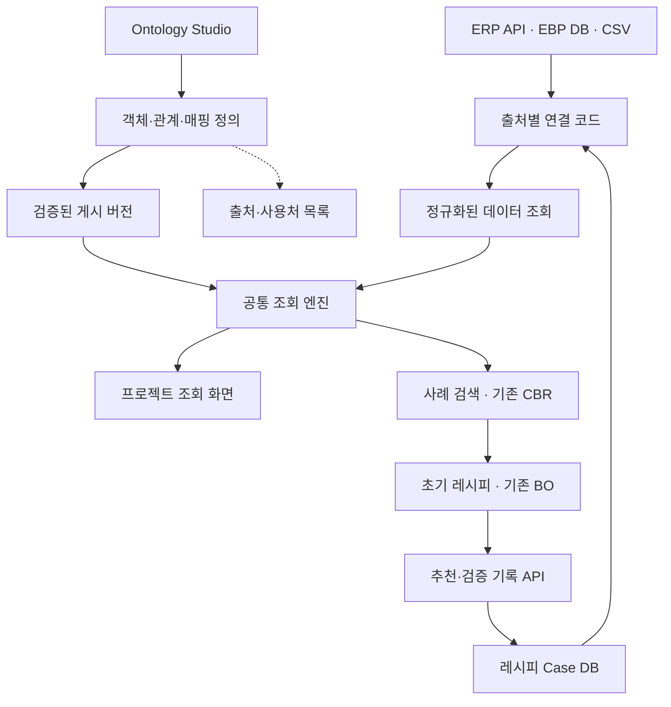

# 사내 Ontology Studio PoC 실행안

> 목표 — 관리자가 객체와 관계를 화면에서 정의·게시하고, EBP와 레시피 추천이라는 서로 다른 업무 모델을 같은 Studio·공통 조회 엔진으로 처리하고, AI 모듈의 사례 조회와 결과 축적까지 연결하는 구조 검증.

작성 기준 — 기존 기획안, 다른 AI의 수정안, 대화 중 검토 의견 통합. 실제 ERP API·EBP DB·개발 인력은 미확인 상태. 아래 데이터 규모와 구현 방식은 PoC 설계 제안이며 착수 점검 결과에 따라 조정.

## 1. 만들 제품과 성공 기준

제품은 관리자용 웹앱 **Ontology Studio**. 주요 화면은 객체·관계 그래프, 속성·출처 설정, 실제 데이터 탐색, 모델 게시·이력 관리. 1단계는 EBP의 프로젝트·장비·이슈 조회. 2단계는 제품·결함·레시피·검증 사례를 구성하고 기존 추천 모듈에 연결하는 확장 검증.

| 핵심 목표 | 필수 확인 결과 |
|---|---|
| 설정이 실행에 반영 | 폼에서 바꾼 관계 설정이 미리보기와 게시 API에 반영 |
| 플랫폼 재사용 | 서로 다른 업무 모델을 동일한 Studio·조회 엔진에서 설정하고 조회 |
| AI 연계 | 공통 API로 얻은 사례를 CBR 또는 조건 검색에 제공하고 추천·검증 이력을 저장·재조회 |
| 확장 방식 검증 | 지원 범위 안의 새 객체·관계를 추가할 때 공통 조회 엔진 수정 없이 동작 |
| 데이터 정확성 | 확인된 샘플의 연결 결과 일치, 미연결·중복·조회 실패 구분 |
| 관리 도구의 효용 | 원본 필드·관계 기준·등록된 사용 화면과 변경 이력 확인 |

설정 시간과 개발 시간은 측정 지표로 기록. 첫 PoC에서 임의의 0.5일·매칭률 80%를 필수 통과 기준으로 적용하지 않음. 비교 가능한 작업이 확보되면 목표값 확정.

## 2. 기능 구조

Studio는 모델 정의를 저장·관리. 조회 엔진은 게시된 정의를 읽어 출처별 데이터를 조회하고 관계를 연결. 초기 저장소는 팀이 운영 가능한 RDB 사용. 관계 그래프는 모델 메타데이터를 시각화.

## 3. 착수 전 현실성 점검

다음 항목을 담당자와 실제 샘플로 확인한 뒤 범위 확정.

| 확인 항목 | 필요한 증거 | 미확보 시 진행 방식 |
|---|---|---|
| ERP 읽기 API 사용 가능 여부 | 샘플 응답, 인증 방식, 필터·페이지 조회 지원 | 승인된 추출본으로 기능 검증, 실제 API 연계는 미검증 표시 |
| EBP 프로젝트·장비 기준 정보 | 실제 테이블 또는 API와 고유 ID | 담당자가 확인한 목록을 PoC 기준 데이터로 사용 |
| 프로젝트와 장비 연결 | 확인된 프로젝트–장비 쌍 | 연결 가능한 사례로 시연 범위 축소 |
| 생산 이슈의 장비 식별 | 원본 식별자와 장비 ID 매핑 | 미매핑 목록 및 수동 확정 기능 사용 |
| 레시피 사례와 모듈 인터페이스 | 제품·결함·촬영 조건·레시피 버전·검증 결과와 CBR 입출력 | 소규모 사례와 조건 검색으로 시작, CBR 연결은 별도 확인 |
| EBP 화면 수정 가능 여부 | 담당자와 개발 환경 | 독립 샘플 화면으로 API 재사용 검증, EBP 직접 통합은 별도 결과로 기록 |

EBP와 레시피는 각각의 업무 모델로 구성. 첫 검증의 재사용 대상은 Studio와 공통 조회 엔진. 실제 동일한 장비·제품을 공유하는 경우에만 공통 ID와 교차 관계 추가.

## 4. 데이터와 관계

### 1단계 EBP 모델

| 객체 | 주요 속성 예시 | 관계 |
|---|---|---|
| 프로젝트 | project_id, project_name, order_no | 프로젝트 → 장비 |
| 장비 | equipment_id, equipment_name, project_id | 장비 → 생산 이슈 |
| 생산 이슈 | issue_id, equipment_id, title, status | 발생 장비와 연결 |

초기 데이터는 프로젝트 2건, 장비 3~5대, 이슈 10~20건 제안. 정상 연결 외에 관련 이슈가 없는 장비, 미매핑 식별자, 중복 ID, 잘못된 필드, 출처 실패 사례 포함.

### 2단계 레시피 추천 모델

| 객체 | 주요 속성 예시 | 관계 |
|---|---|---|
| 제품 | product_id, material, surface_type | 제품 → 결함 사례 |
| 결함 사례 | defect_case_id, product_id, defect_type, size | 결함 사례 → 평가 사례 |
| 레시피 버전 | recipe_version_id, 조명 채널·밝기, exposure, gain | 레시피 버전 → 평가 사례 |
| 평가 사례 | evaluation_id, defect_case_id, recipe_version_id, 점수, 판정, image_ref | 제품·결함에 특정 레시피를 적용한 결과 |
| 추천 실행 | run_id, target_case_id, model_version, method, seed_recipe_id | 추천 실행 → 평가 사례 |

평가 사례는 결함과 레시피의 다대다 적용을 개별 기록으로 표현. 각 관계는 단순 키 연결로 처리. 합성·실측 여부, 촬영 장치 구성, 지표 산출 버전과 시각 기록. 재질은 초기에는 제품 속성으로 관리. 레시피 파라미터는 불변 버전으로 보존.

초기 제안은 제품 2종, 결함 사례 3~5건, 레시피 버전 5~10건, 평가 사례 10~20건. 구조·연계 검증용 규모. 추천 품질이나 CBR의 일반화 성능 판단에는 별도 데이터와 평가 계획 필요.

ID 매핑에는 출처, 원본 식별자, 공통 장비 ID, 확정자, 확정 시각과 변경 이력 저장. 같은 출처·원본 식별자가 여러 장비를 가리키면 충돌로 표시. 장비명만 있는 경우 자동 확정보다 담당자 확인 우선.

## 5. 첫 버전 구현 범위

| 기능 | 구현 내용 | 완료 기준 |
|---|---|---|
| 모델 편집 | 객체·속성·데이터 출처·관계 등록, 폼 편집, 읽기 전용 관계 그래프 | 폼 저장 후 그래프와 미리보기 반영 |
| 객체 탐색 | 객체 목록·상세·관련 객체, 원본 필드와 미매핑 표시 | 업무 모델별 실제 사례와 관계 정확히 구분 |
| 초안·게시 | 초안 저장, 검증 결과, 변경 요약, 게시·복구 | 초안과 게시 조회 분리, 실패 시 기존 버전 유지 |
| 출처·사용처 | 등록된 원본 필드·API·사용 화면·AI 모듈 목록 | 변경된 필드를 사용하는 등록 화면 식별 |
| 공통 API | 목록, ID 조회, 관계 1단계 조회 | EBP와 레시피 모델에 같은 목록·필터·ID·관계 조회 엔진 적용 |
| 접근 관리 | 지정 관리자만 편집·게시, 테스트 사용자 조회 권한 | 서버에서 권한 확인 |

관계 그래프는 첫 화면에 유지. 드래그 연결 편집과 출처·사용처 그래프는 후속 구현. 소비 화면의 사용 속성은 수동 등록하고, 등록 범위 안에서 영향 확인.

### 설정과 코드의 경계

- 설정 대상은 객체, 단순 속성, 원본 필드 매핑, 고유 키, 동등 키 기반 일대다 관계.
- 코드 대상은 출처 인증·호출, 공통 조회·검증, 지원하지 않는 변환과 업무 계산.
- 연결 코드는 목록·ID·필터 조회 등 공통 입력·출력 규약을 제공. 필터를 원본에서 지원하지 않으면 PoC 추출 데이터에서 수행.
- 지원하는 출처와 관계 형태 안의 추가는 설정으로 처리. 새로운 프로토콜이나 관계 연산 추가는 확장 개발로 기록.
- 새 화면 구성에는 화면 코드 작성 가능. 재사용 판정은 공통 조회 엔진의 변경 여부와 업무별 추가 연결 코드로 확인.

### 2단계 추천 연계의 구현 범위

1. 대상 제품·결함 선택 후 공통 API에서 재질·결함 유형과 촬영 장치 호환 조건으로 과거 평가 사례 조회.
2. 기존 CBR이 있으면 어댑터로 입력 변환해 후보 순위와 초기 Seed 반환. 미준비 시 조건 검색으로 후보와 선정 근거 표시하고 CBR 실행 여부 명시.
3. 기존 BO가 준비돼 있으면 Seed를 입력해 후보 탐색 실행. 장비 연동이 준비되지 않았다면 기존 촬영 데이터 기반 오프라인 실행 또는 전문가 선택으로 연결 동작 검증. 실제 장비 탐색 여부를 결과에 기록.
4. 추천 실행과 선택 레시피 버전 저장. 실제 검증 결과 확보 후 별도 평가 사례로 추가하고 공통 API로 재조회.
5. 다음 검색에서 검증 상태·합성/실측 구분을 적용해 적합한 사례만 후보로 사용.

결과 기록은 레시피 전용 API와 Case DB로 구현. run_id·evaluation_id의 고유성으로 재시도 중복 방지, 연결 대상 ID 검증, 기록 단위 트랜잭션 적용. 실패한 검증은 실패 상태로 기록. 모델 게시와 사례 기록은 별도 동작. 범용 쓰기 엔진은 후속 확장 대상.

레시피 UI는 대상 입력, 검색된 사례와 근거, 추천 Seed, 실행·검증 상태, 저장 이력으로 구성. 플랫폼 검증과 추천 성능 평가를 별도 항목으로 기록.

## 6. 조회 방식과 장애 처리

첫 구현은 고정된 추출 데이터로 정확성과 게시 동작 검증. 이후 접근 가능한 실제 출처 1곳 이상을 연결해 원본 호출의 지연·필터·페이지 조회 동작 확인. 실제 출처를 연결하지 못한 경우 결과는 샘플 기반 기술 검증으로 명시.

실시간 조회는 원본의 키·필터 조회가 가능한 경우 적용. 전체 목록만 제공하거나 느린 API는 제한된 데이터 적재 방식 검토. 화면에서 출처와 취득 시각 표시.

출처 실패는 정상 빈 결과와 구분. 객체의 기준 출처 실패 시 해당 객체 조회 실패 표시. 선택적 관계 출처 실패 시 본문과 함께 해당 관계의 조회 실패 상태 반환. 타임아웃·반복 호출·전체 데이터 다운로드 여부 기록.

응답 속도는 데이터 수, 관계 수, 반복 횟수, 원본 호출 시간을 함께 기록. 2초는 소규모 시연의 참고 목표. 원본 호출 지연과 공통 조회 처리 시간을 분리 측정.

## 7. 게시 검증과 복구

| 조건 | 처리 |
|---|---|
| 필수 원본 필드 누락, 변환 규칙 없는 키 형식 불일치 | 게시 차단 |
| 검증 데이터의 고유 ID 빈값·중복 | 해당 모델 게시 차단 |
| 사전에 확정한 테스트 연결 결과 불일치 | 게시 차단 |
| 관련 이슈가 없는 장비 등 정상 0건 | 정상 결과 |
| 미매핑 데이터 존재 | 대상과 건수 표시, 업무 영향 확인 후 게시 판단 |
| 등록된 소비 화면의 필수 속성 삭제·API 식별자 변경 | 호환성 해결 전 게시 차단 |
| 표시명 변경 | 내부 식별자 유지 시 허용 |
| 원본 접속 실패로 검증 불가능 | 검증 미완료 표시, 재검증 후 게시 |

검증에는 대상 데이터 범위·취득 시각·결과 저장. 소규모 샘플 검증과 전체 데이터 검증을 구분. 게시 모델은 불변 버전으로 저장하고 현재 버전 참조를 원자적으로 전환. 요청 하나에서는 같은 모델 버전을 사용. 동시 편집·게시 시 기준 버전 변경을 확인해 덮어쓰기 방지.

복구는 모델 정의의 이전 버전 활성화. 데이터와 ID 매핑은 별도 변경 이력 관리. 복구 시험에서는 원본과 매핑을 고정하고 결과 비교. 과거 데이터까지 재현하려면 데이터·매핑 스냅샷이 추가로 필요.

## 8. 개발 순서와 산출물

| 단계 | 작업 | 산출물 및 통과 기준 |
|---|---|---|
| 1 | 실제 데이터·ID·업무 담당 확인 | 출처 목록, 샘플, 정답 연결표, 미확보 항목 |
| 2 | 고정 데이터로 공통 엔진 구현 | 객체·관계 API와 정상·빈값·오연결 시험 결과 |
| 3 | Studio와 게시 구현 | 폼·그래프·미리보기·게시·복구 동작 |
| 4 | 첫 업무 화면 연결 | 프로젝트 → 장비 → 이슈 조회 |
| 5 | 레시피 모델과 검색 추가 | 같은 Studio·조회 엔진으로 다른 모델 처리, CBR 또는 조건 검색 입력 확인 |
| 6 | 추천·검증 기록 연결 | 추천 실행과 레시피 버전 저장, 검증 결과 추가·재조회, 재시도 중복 없음 |
| 7 | 실제 출처 연계 및 종료 평가 | 연계 결과, 장애·응답 측정, 확장 비용과 제약 목록 |

일정은 1단계와 공통 조회 엔진의 초기 구현 후 산정. 서버 담당은 출처 연결·엔진·버전 처리, 화면 담당은 Studio·탐색·샘플 화면, 업무 담당은 ID·정답 확인 수행. 겸임 가능하나 원본 데이터 의미 확인 담당 지정 필요.

## 9. 확장 비용 측정

| 작업 항목 | 기록할 내용 |
|---|---|
| 데이터 확보·정리 | 누락·중복·ID 정비 시간 |
| 출처 연결 | 연결 코드 작성·수정과 시험 시간 |
| 모델 설정 | 객체·속성·관계 등록 시간 |
| 공통 엔진 | 변경 유무와 이유 |
| 화면 개발 | 화면 구성·API 연결 시간 |
| 검증 | 정확성·기존 업무 영향 확인 시간 |

비교 대상은 같은 조회 요구사항을 개별 API로 구현하는 방식. 실제 기록 또는 근거를 적은 추정치를 사용하고 실측·추정을 구분. 플랫폼 초기 개발 비용과 두 번째 업무의 추가 비용을 별도로 기록. 두 번째 업무 1건의 결과는 제한된 재사용 증거로 해석.

## 10. 시연과 최종 판단

1. Studio에서 프로젝트·장비·이슈 관계 확인.
2. 관계 설정 폼과 실제 장비 데이터 미리보기 확인.
3. 정상 초안 게시 후 첫 업무 화면 반영 확인.
4. Studio에 제품·결함·레시피·평가 사례 모델 추가 후 공통 API로 조회.
5. 조회 사례를 기존 CBR 또는 조건 검색에 제공해 초기 Seed 선정.
6. 추천 실행과 검증 결과 저장 후 다음 조회에서 사례 확인.
7. 오연결·출처 실패·필수 속성 삭제 사례의 처리 확인.
8. 동일한 데이터·매핑에서 이전 모델 복구 확인.
9. 실제 원본 연계 여부와 추가 개발 작업량 제시.

**확장 진행 조건**은 설정이 실제 조회에 반영되고, 지원 범위 안에서 두 번째 업무가 공통 엔진 수정 없이 연결되며, 예상 결과와 오류 상태가 정확히 구분되며 추천·검증 기록의 재조회가 가능한 것. CBR·BO·실장비 연결은 각각 실제 실행, 대체 검색, 오프라인 검증 여부를 결과표에 표시. 매번 엔진을 수정해야 한다면 객체별 예외와 출처 규약을 검토해 지원 범위 재정의. 샘플만 검증했다면 다음 목표는 실제 데이터 연계.

후속 기능은 이슈 완료 Action 1개, 권한·변경 이력, 출처별 적재·캐시, 사용처 자동 수집 순으로 실제 필요에 따라 추가. 견적 결재, 범용 화면 빌더, 범용 워크플로우 엔진, 실장비의 자동 촬영·제어 연동은 별도 단계로 산정. 기존 CBR·BO의 입출력 연결은 2단계에서 준비 수준에 맞춰 검증.

## 참고

Palantir 기능명은 벤치마킹 방향을 설명하기 위한 참고. 위 구현 내용과 판정 기준은 사내 PoC 설계 제안.

- [Ontology Manager](https://www.palantir.com/docs/foundry/ontology-manager/overview)
- [Data Lineage](https://www.palantir.com/docs/foundry/data-lineage/overview/)
- [Workflow Lineage](https://www.palantir.com/docs/foundry/workflow-lineage/overview)
